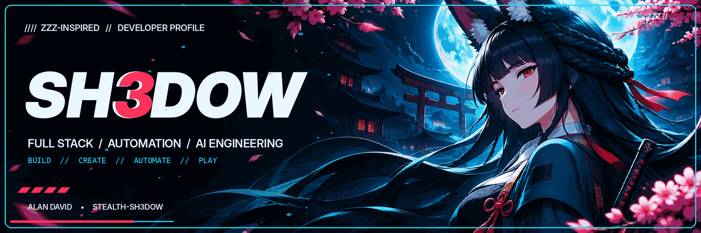
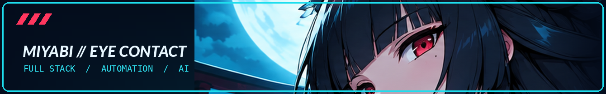
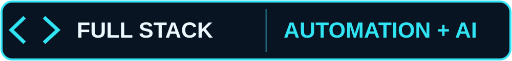
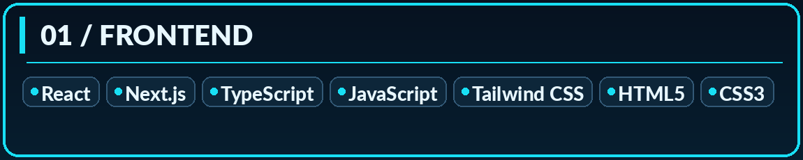
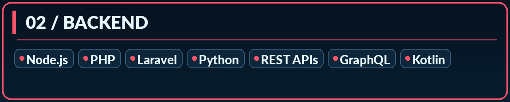
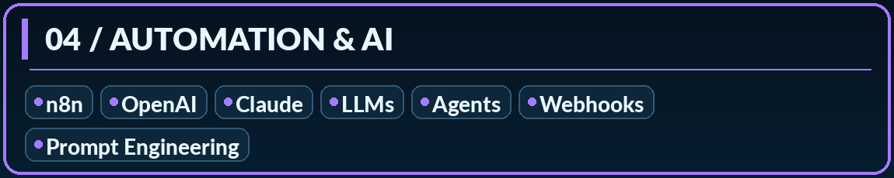
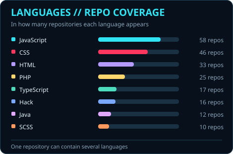
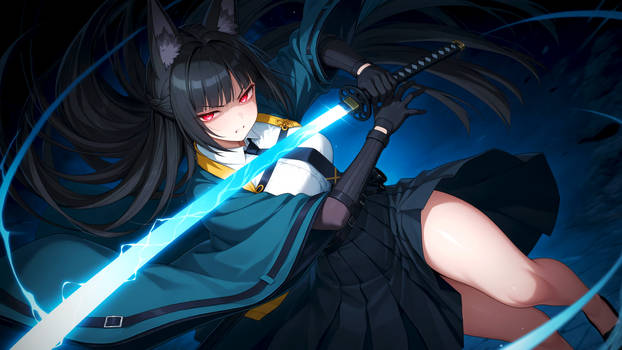

<!--
  SH3DOW // GitHub Profile README v2.0
  GitHub username: Stealth-Sh3dow
  Required repository: Stealth-Sh3dow/Stealth-Sh3dow (PUBLIC)
  All local images are stored in ./assets/ .
  Keep the image filenames unchanged when uploading.
-->

<div align="center">
  
  <br />
  <!--  -->
  <br /><br />

 <!--<a href="https://alan-david-portfolio.dev/"></a>-->
  <a href="https://www.linkedin.com/in/alan-silva-pereira-david/"></a>
  <a href="https://auracriativa.com/"></a>
  <br /><br />
  
</div>

<br />

## `01 // AGENT DOSSIER` <sub>ABOUT ME</sub>

```ts
const sh3dow = {
  name: "Alan David",
  alias: "SH3DOW",
  github: "Stealth-Sh3dow",
  role: "Full Stack Developer",
  experience: "5+ years",
  base: "Brazil",
  focus: ["Web", "Automation", "AI", "E-commerce"],
  sideQuests: ["Game modding", "Creative tools", "Anime"],
  status: "Building things I wish existed."
};
```

Hey! I'm **Alan David**, also known as **SH3DOW**. I'm a full stack developer with **5+ years of experience** designing and building websites, web applications, e-commerce experiences, SaaS products, APIs and automation systems.

I enjoy connecting the dots between **frontend, backend, databases, cloud platforms, AI and business workflows**. Outside client work, I experiment with desktop customization, game mods, interfaces and tools inspired by the things I love.

- **Web engineering:** React, Next.js, TypeScript, Node.js, PHP/Laravel and Python.
- **Automation & integrations:** n8n, webhooks, REST/GraphQL, CRMs, ERPs, synchronization and resilient workflows.
- **AI engineering:** LLM integrations, AI agents, OpenAI, Claude and prompt engineering.
- **Commerce & payments:** Shopify, Nuvemshop, WBuy, AppMax, checkout and order flows.
- **CRM & marketing tech:** GoHighLevel/LeadConnector, Meta Ads, Google Ads, GTM and Analytics.
- **Creative development:** Hydra Launcher customization, themes, effects and desktop tooling.

> 🦊 **Code is my craft. Building weirdly specific things is my hobby.**

<div align="center"></div>

## `02 // TECH ARSENAL` <sub>LANGUAGES, FRAMEWORKS & TOOLS</sub>

<table width="100%">
  <tr>
    <td width="50%" align="center"></td>
    <td width="50%" align="center"></td>
  </tr>
  <tr>
    <td align="center"></td>
    <td align="center"></td>
  </tr>
  <tr>
    <td align="center"></td>
    <td align="center"></td>
  </tr>
  <tr>
    <td colspan="2" align="center"></td>
  </tr>
</table>

<details>
<summary><b>🛠️ Expanded toolkit</b></summary>

<br />

| Domain | Technologies and capabilities |
| :--- | :--- |
| **Frontend & UI** | React, Next.js, TypeScript, JavaScript, HTML5, CSS3, Tailwind CSS, responsive design and UI/UX |
| **Backend & Mobile** | Node.js, PHP, Laravel, Python, Kotlin/Android, API design, REST, GraphQL and webhooks |
| **Data & Storage** | PostgreSQL, MySQL, Supabase, Firebase, SQL, data modeling and synchronization |
| **Automation & Systems** | n8n, workflow orchestration, external APIs, queues, pagination, rate limits, retries, error handling and monitoring |
| **AI & LLMs** | OpenAI, Claude, agent workflows, model integrations, structured outputs and prompt engineering |
| **E-commerce & Payments** | Shopify, Nuvemshop, WBuy, AppMax, storefronts, webhooks, checkout, orders and customer data |
| **CRM & Marketing** | GoHighLevel, LeadConnector, Meta Ads, Google Ads, Google Tag Manager, Google Analytics and conversion tracking |
| **Infrastructure & Dev Tools** | Docker, Git, GitHub, Vercel, Linux, VPS, CI/CD, deployment workflows and environment configuration |
| **Creative Development** | Electron, modding, Hydra Launcher, CSS themes, motion effects, desktop apps, wallpapers and interface customization |

</details>

<div align="center"></div>

## `03 // CURRENT MISSIONS` <sub>FEATURED PROJECTS</sub>

<table width="100%">
  <tr>
    <td width="33%" valign="top">
      
      <br /><b>🎮 SPECTRA / Launcher Mods</b><br />
      <sub>Hydra Launcher customization: themes, wallpapers, effects, Safe Mode, mod management and desktop tooling.</sub>
      <br /><code>Node.js</code> <code>Electron</code> <code>UI/UX</code>
    </td>
    <td width="33%" valign="top">
      
      <br /><b>💗 Aura Criativa / Aura OS</b><br />
      <sub>A growing ecosystem of web apps, CRM workflows, automations and AI-driven business tools.</sub>
      <br /><code>Next.js</code> <code>Supabase</code> <code>n8n</code>
    </td>
    <td width="33%" valign="top">
      
      <br /><b>⚡ Integrations & Automation</b><br />
      <sub>Connectors between stores, CRMs, APIs and external platforms, with reliable data flows.</sub>
      <br /><code>REST</code> <code>Webhooks</code> <code>AI</code>
    </td>
  </tr>
</table>

<sub>🔒 A significant part of my work lives in private repositories. Client source code, credentials and sensitive data remain private.</sub>

<div align="center"></div>

## `04 // PROFESSIONAL FOCUS` <sub>WHAT I BUILD</sub>

<div align="center">
  
</div>

I work across the entire delivery cycle, from planning and UI to APIs, database modeling, integration architecture, deployment, iteration and maintenance. I especially enjoy projects where **software, automation and thoughtful design** meet.

<div align="center"></div>

## `05 // GITHUB STATS` <sub>CODE & CONTRIBUTIONS</sub>

<div align="center">
  
  
</div>

<div align="center"></div>

## `06 // ACTIVITY LOG` <sub>ONGOING QUEST</sub>

<div align="center">

**PUBLIC PROJECTS · PRIVATE CONTRIBUTIONS · ALWAYS LEARNING**

`PLAN` &nbsp; `BUILD` &nbsp; `AUTOMATE` &nbsp; `DEBUG` &nbsp; `REPEAT`

</div>

<div align="center"></div>

## `07 // BEYOND THE CODE` <sub>PERSONAL QUESTS</sub>

- 🎮 **Game mods & customization:** launcher themes, visual effects, wallpapers and desktop experiences.
- 🦊 **Anime & games:** a particular soft spot for Zenless Zone Zero and Miyabi-inspired visuals.
- 🧩 **Creative tools:** utilities, UI experiments and little quality-of-life improvements.
- ⚡ **Automation for fun:** if a task repeats, I'll probably try building a workflow for it.

<div align="center"></div>

## `08 // CONNECTIONS` <sub>FIND ME ONLINE</sub>

<div align="center">
  <a href="https://www.linkedin.com/in/alan-silva-pereira-david/"></a>
  <!-- <a href="https://alan-david-portfolio.dev/"></a> -->
  <a href="https://auracriativa.com/"></a>
  <a href="https://github.com/Stealth-Sh3dow"></a>
</div>

<!--
  OPTIONAL SH3DOW NETWORK:
  Add your verified YouTube, TikTok, Discord and Steam profile URLs here.
  No social links have been invented or guessed.
-->

<br />

<div align="center">
  
  <br />
  <sub>🦊 SH3DOW // END OF TRANSMISSION</sub>
</div>
