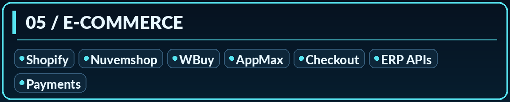
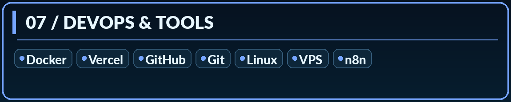
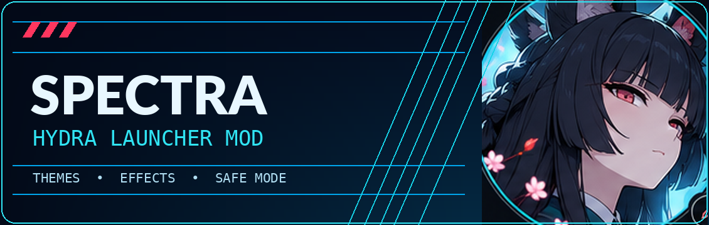
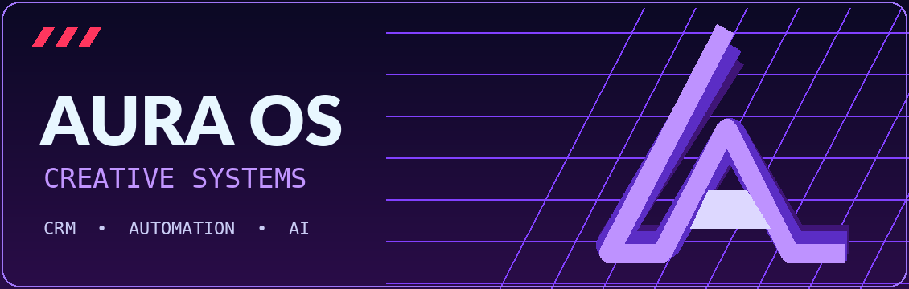
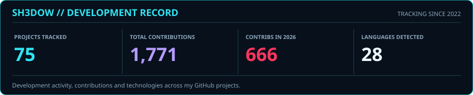
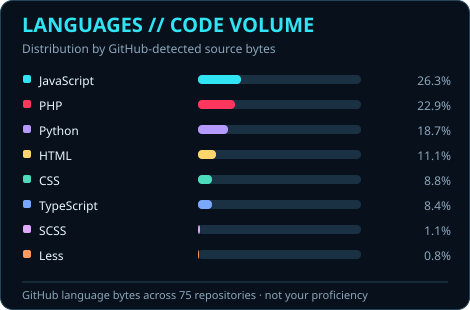

<!--
  ============================================================
  SH3DOW // GITHUB PROFILE
  VERSION: 3.1
  USERNAME: Stealth-Sh3dow
  THEME: ZENLESS ZONE ZERO / HOSHIMI MIYABI

  CODE // AUTOMATE // BUILD // PLAY

  Assets: ./assets/
  ============================================================
-->

 

<!-- SYSTEM STATUS: FOUR-COLUMN GRID -->

<table width="100%">
<tr>
<td width="25%" align="center"></td>
<td width="25%" align="center"></td>
<td width="25%" align="center"></td>
<td width="25%" align="center"></td>
</tr>
</table>

<!-- ANIMATED INTRODUCTION -->

 

<!-- QUICK ACCESS -->

 

<!-- ======================================================= -->
<!-- 01 // AGENT DOSSIER                                      -->
<!-- ======================================================= -->

## `01 // AGENT DOSSIER` IDENTITY & BACKGROUND

<table width="100%">
<tr>

<td width="45%" valign="top">

<h3>🦊 Operator Information</h3>

<pre><code>const sh3dow = {
  name: "Alan David",
  alias: "SH3DOW",
  github: "Stealth-Sh3dow",

  class: "Full Stack Developer",
  experience: "5+ years",
  location: "Brazil",

  focus: [
    "Software Engineering",
    "Automation",
    "AI",
    "E-commerce"
  ],

  status: "Building"
};</code></pre>

</td>

<td width="55%" valign="top">

<h3>⚡ About the Operator</h3>

Hey! I'm <b>Alan David</b>, also known as <b>SH3DOW</b>.

I'm a Full Stack Developer with over <b>5 years of experience</b> building applications, business systems, e-commerce platforms, APIs and automation solutions.

I work across the entire development stack, combining software engineering, cloud infrastructure, artificial intelligence and automation.

Outside professional development, I enjoy experimenting with game modifications, custom interfaces, desktop applications and creative tools.

<b>Current objective:</b> 
Build useful software, explore emerging technologies and create things I genuinely enjoy using.

</td>

</tr>
</table>

<!-- SPECIALIZATION GRID -->

<table width="100%">
<tr>
<td width="25%" align="center"></td>
<td width="25%" align="center"></td>
<td width="25%" align="center"></td>
<td width="25%" align="center"></td>
</tr>
</table>

> 🦊 **Code is my craft. Building weirdly specific things is my hobby.**

<!-- ======================================================= -->
<!-- 02 // TECH ARSENAL                                       -->
<!-- ======================================================= -->

## `02 // TECH ARSENAL` LANGUAGES, FRAMEWORKS & TOOLS

### `PRIMARY TECHNOLOGIES`

 

<!-- TECHNOLOGY PANELS -->

<table width="100%">
<tr>
<td width="50%" align="center"></td>
<td width="50%" align="center"></td>
</tr>
<tr>
<td align="center"></td>
<td align="center"></td>
</tr>
<tr>
<td align="center"></td>
<td align="center"></td>
</tr>
<tr>
<td colspan="2" align="center"></td>
</tr>
</table>

<!-- EXPANDABLE TECHNOLOGY DATABASE -->

<b>🛠️ EXPAND FULL TECHNOLOGY DATABASE</b>

 

| Category | Technologies & Experience |
|:---|:---|
| **Frontend Engineering** | React, Next.js, JavaScript, TypeScript, HTML5, CSS3, Tailwind CSS, responsive interfaces |
| **Backend Engineering** | Node.js, PHP, Laravel, Python, REST APIs, GraphQL |
| **Mobile Development** | Kotlin, Android development, Android Studio |
| **Databases** | PostgreSQL, MySQL, Supabase, Firebase, SQL, data modeling |
| **Automation** | n8n, webhooks, scheduled workflows, synchronization, API integrations |
| **Artificial Intelligence** | OpenAI, Claude, LLM APIs, AI agents, prompt engineering, structured outputs |
| **E-commerce** | Shopify, Nuvemshop, WBuy, AppMax, storefronts, checkout, payments |
| **CRM Systems** | GoHighLevel, LeadConnector, pipelines, custom fields, CRM integrations |
| **Marketing Technology** | Meta Ads, Google Ads, GTM, Google Analytics, pixels |
| **Cloud & DevOps** | Docker, Vercel, Linux, VPS, GitHub Actions, CI/CD |
| **System Architecture** | API integrations, retries, rate limits, pagination, error handling |
| **Creative Development** | Electron, CSS customization, themes, animations, desktop tools |
| **Game Modding** | Hydra Launcher, custom interfaces, wallpapers, visual effects |
| **Developer Tools** | VS Code, Git, GitHub, Postman, API debugging |

 

<!-- ======================================================= -->
<!-- 03 // CURRENT MISSIONS                                   -->
<!-- ======================================================= -->

## `03 // CURRENT MISSIONS` PROJECTS & EXPERIMENTS

**SELECTED PROJECTS FROM MY DEVELOPMENT JOURNEY**

`SOFTWARE` · `AUTOMATION` · `CREATIVE TOOLS`

 

<table width="100%">
<tr>

<td width="50%" valign="top">

<h3>🎮 SPECTRA / Launcher Mods</h3>

A personal project focused on extending and customizing the Hydra Launcher experience.

<b>Features & Experiments</b>

<ul>
<li>Custom themes and interfaces</li>
<li>Dynamic wallpapers</li>
<li>Visual effects and transitions</li>
<li>Safe Mode</li>
<li>Mod management tools</li>
<li>Desktop automation</li>
</ul>

<code>Node.js</code>
<code>Electron</code>
<code>JavaScript</code>
<code>CSS</code>

  

</td>

<td width="50%" valign="top">

<h3>💗 Aura Criativa / Aura OS</h3>

An ecosystem of applications and automation solutions supporting creative and business operations.

<b>Areas of Development</b>

<ul>
<li>Web applications and dashboards</li>
<li>CRM and lead management</li>
<li>Business process automation</li>
<li>AI-powered workflows</li>
<li>Data integrations</li>
<li>Operational intelligence</li>
</ul>

<code>Next.js</code>
<code>Supabase</code>
<code>TypeScript</code>
<code>n8n</code>

  

</td>

</tr>
</table>

<!-- INTEGRATION PROJECT -->

<table width="100%">
<tr>

<td width="38%" valign="middle">

</td>

<td width="62%" valign="middle">

<h3>⚡ Integrations & Automation</h3>

Building connections between platforms, APIs and business systems.

My integration work includes e-commerce platforms, CRMs, payment services, external databases, scheduling systems and intelligent workflows.

<code>REST</code>
<code>GraphQL</code>
<code>Webhooks</code>
<code>n8n</code>
<code>AI</code>

</td>

</tr>
</table>

> 🔒 Many of my professional projects live in private repositories. Client source code, credentials and business information remain confidential.

<!-- ======================================================= -->
<!-- 04 // PROFESSIONAL FOCUS                                 -->
<!-- ======================================================= -->

## `04 // PROFESSIONAL FOCUS` WHAT I BUILD

 

<table width="100%">
<tr>

<td width="33%" valign="top">

<h3>01 // BUILD</h3>

<b>Full Stack Development</b>

Web applications, APIs, SaaS platforms, interfaces and custom software solutions.

</td>

<td width="33%" valign="top">

<h3>02 // CONNECT</h3>

<b>Automation & Integrations</b>

Connecting services, synchronizing data and designing reliable workflows.

</td>

<td width="33%" valign="top">

<h3>03 // INTELLIGENCE</h3>

<b>AI & Data Systems</b>

Integrating language models, intelligent agents, databases and automation.

</td>

</tr>
</table>

`DESIGN` → `DEVELOP` → `INTEGRATE` → `AUTOMATE` → `DEPLOY`

 

<!-- ======================================================= -->
<!-- 05 // GITHUB STATS                                       -->
<!-- ======================================================= -->

## `05 // GITHUB STATS` ACTIVITY & LANGUAGES

<table width="100%">
  <tr>
    <td width="54%" align="center" valign="top">
      
    </td>
    <td width="46%" align="center" valign="top">
      
    </td>
  </tr>
</table>

 

  

 

  
<b>📊 Explore language distribution by code volume</b>

   
  

    
  

 

  

 

## `06 // ACTIVITY LOG` DEVELOPMENT ACTIVITY

**PUBLIC PROJECTS · PRIVATE CONTRIBUTIONS · CONTINUOUS DEVELOPMENT**

 

<table width="100%">
<tr>

<td width="33%" align="center" valign="top">

<h3>01 // CODE</h3>

<b>Developing</b>

Web apps, APIs, systems and custom tools.

</td>

<td width="33%" align="center" valign="top">

<h3>02 // AUTOMATE</h3>

<b>Optimizing</b>

Workflows, integrations and intelligent processes.

</td>

<td width="33%" align="center" valign="top">

<h3>03 // EXPLORE</h3>

<b>Experimenting</b>

AI, creative interfaces, games and emerging technologies.

</td>

</tr>
</table>

`PLAN` → `BUILD` → `DEBUG` → `SHIP` → `REPEAT`

<!-- ======================================================= -->
<!-- 07 // BEYOND THE CODE                                    -->
<!-- ======================================================= -->

## `07 // BEYOND THE CODE` PERSONAL QUESTS

**NOT EVERYTHING HAS TO BE A CLIENT PROJECT**

 

<table width="100%">
<tr>

<td width="50%" valign="top">

<h3>🎮 Gaming & Modding</h3>

<ul>
<li>Game modifications</li>
<li>Custom launchers</li>
<li>Interface customization</li>
<li>Wallpapers and visual effects</li>
<li>Desktop utilities</li>
<li>Quality-of-life improvements</li>
</ul>

</td>

<td width="50%" valign="top">

<h3>🦊 Anime & Creative Development</h3>

<ul>
<li>Zenless Zone Zero</li>
<li>Hoshimi Miyabi</li>
<li>Anime-inspired interfaces</li>
<li>Creative UI experiments</li>
<li>Cyberpunk aesthetics</li>
<li>Personal development projects</li>
</ul>

</td>

</tr>
</table>

 

 

<b>CURRENT OBSESSION</b>

 

 

<i>Sometimes the best projects are the ones you build just because you want them to exist.</i>

<!-- ======================================================= -->
<!-- 08 // CONNECTIONS                                       -->
<!-- ======================================================= -->

## `08 // CONNECTIONS` FIND ME ONLINE

**FIND ME AROUND THE INTERNET**

 

<!-- UNIFIED SOCIAL GRID -->

<table width="100%">
<tr>

<td width="25%" align="center">

</td>

<td width="25%" align="center">

</td>

<td width="25%" align="center">

</td>

<td width="25%" align="center">

</td>

</tr>
</table>

 

<!-- ======================================================= -->
<!-- 09 // END OF TRANSMISSION                                -->
<!-- ======================================================= -->

## `09 // END OF TRANSMISSION` SYSTEM IDLE

<b>THANKS FOR VISITING MY LITTLE CORNER OF GITHUB.</b>

  

  

 

Inspired by Zenless Zone Zero and Hoshimi Miyabi. 
Personal fan-made developer profile.

  

 

🦊 SH3DOW // SYSTEM ONLINE

<!-- ======================================================= -->
<!-- SH3DOW // END OF PROFILE                                 -->
<!-- ======================================================= -->
