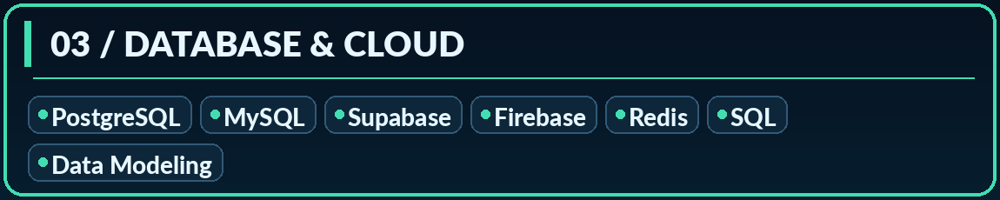
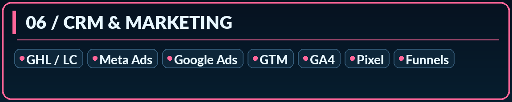
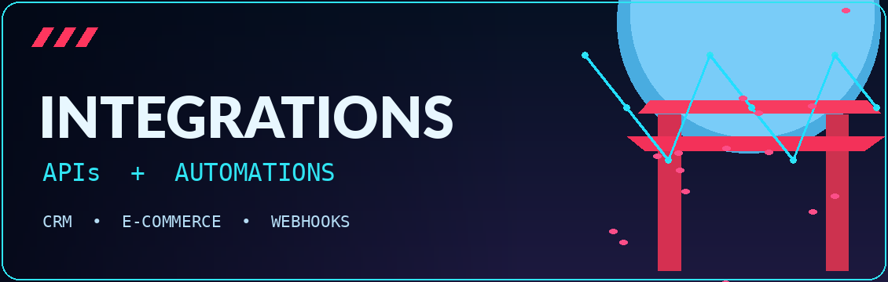
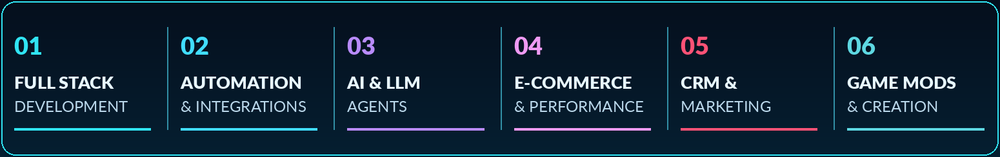
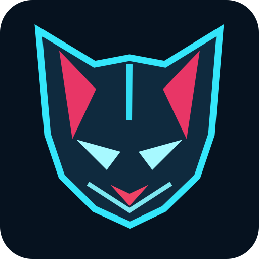

<!--
  ╔══════════════════════════════════════════════════════════╗
  ║                                                          ║
  ║   SH3DOW // PERSONAL GITHUB PROFILE                       ║
  ║   VERSION: 3.0                                            ║
  ║                                                          ║
  ║   USERNAME: Stealth-Sh3dow                                ║
  ║   THEME: ZENLESS ZONE ZERO / HOSHIMI MIYABI               ║
  ║                                                          ║
  ║   CODE. AUTOMATE. BUILD. PLAY.                            ║
  ║                                                          ║
  ╚══════════════════════════════════════════════════════════╝

  All local assets are stored in ./assets/

  This README uses GitHub-compatible Markdown and HTML.
  No custom JavaScript or external CSS required.
-->

<!-- ======================================================= -->
<!-- 00 // INITIALIZATION                                     -->
<!-- ======================================================= -->

  

   

  

  

  

  

    

  

   

  

  

  

 

<!-- ======================================================= -->
<!-- 01 // AGENT DOSSIER                                      -->
<!-- ======================================================= -->

## `01 // AGENT DOSSIER` IDENTITY & BACKGROUND

<table width="100%">

<tr>

<td width="48%" valign="top">

<h3>🦊 Operator Information</h3>

<pre><code>const sh3dow = {
  name: "Alan David",
  alias: "SH3DOW",
  github: "Stealth-Sh3dow",

  class: "Full Stack Developer",

  experience: "5+ years",

  location: "Brazil",

  specialization: [
    "Software Engineering",
    "Automation",
    "Artificial Intelligence",
    "E-commerce"
  ],

  currentStatus: "Building"
};</code></pre>

</td>

<td width="52%" valign="top">

<h3>⚡ About the Operator</h3>

Hey! I'm <b>Alan David</b>, also known as <b>SH3DOW</b>.

I'm a Full Stack Developer with over <b>5 years of experience</b> building web applications, business systems, e-commerce solutions, APIs and automation platforms.

I enjoy combining software engineering, artificial intelligence and creative development to turn ideas into functional products.

Outside professional work, I spend time experimenting with game modifications, custom interfaces, desktop utilities and technologies that catch my attention.

<b>Current objective:</b> 
Build useful software, explore new technologies and create things I would genuinely enjoy using.

</td>

</tr>

</table>

  

  

  

  

 

> 🦊 **Code is my craft. Building weirdly specific things is my hobby.**

  

<!-- ======================================================= -->
<!-- 02 // TECH ARSENAL                                       -->
<!-- ======================================================= -->

## `02 // TECH ARSENAL` LANGUAGES, FRAMEWORKS & TOOLS

### `PRIMARY TECHNOLOGIES`

  

 

<table width="100%">

<tr>
<td width="50%" align="center">

</td>

<td width="50%" align="center">

</td>
</tr>

<tr>
<td align="center">

</td>

<td align="center">

</td>
</tr>

<tr>
<td align="center">

</td>

<td align="center">

</td>
</tr>

</table>

 

<b>🛠️ EXPAND FULL TECHNOLOGY DATABASE</b>

 

| Category | Technologies & Experience |
|:---|:---|
| **Frontend Engineering** | React, Next.js, JavaScript, TypeScript, HTML5, CSS3, Tailwind CSS, responsive interfaces |
| **Backend Engineering** | Node.js, PHP, Laravel, Python, API architecture, REST, GraphQL |
| **Mobile Development** | Kotlin, Android development, Android Studio |
| **Databases** | PostgreSQL, MySQL, Supabase, Firebase, SQL, data modeling |
| **Automation** | n8n, webhooks, integrations, scheduled workflows, data synchronization |
| **Artificial Intelligence** | OpenAI, Claude, LLM APIs, AI agents, prompt engineering, structured outputs |
| **E-commerce** | Shopify, Nuvemshop, WBuy, AppMax, storefronts, checkout, payments |
| **CRM Systems** | GoHighLevel, LeadConnector, pipelines, custom fields, CRM integrations |
| **Marketing Technology** | Meta Ads, Google Ads, Google Tag Manager, Analytics, pixels |
| **Cloud & DevOps** | Docker, Vercel, Linux, VPS, GitHub Actions, CI/CD |
| **System Architecture** | API integrations, retries, rate limits, pagination, error handling |
| **Creative Development** | Electron, CSS customization, themes, animations, desktop tools |
| **Game Modding** | Hydra Launcher, custom interfaces, wallpapers, visual effects |
| **Developer Tools** | VS Code, Git, GitHub, Postman, API debugging |

 

  

<!-- ======================================================= -->
<!-- 03 // CURRENT MISSIONS                                   -->
<!-- ======================================================= -->

## `03 // CURRENT MISSIONS` PROJECTS & EXPERIMENTS

**SELECTED PROJECTS FROM MY DEVELOPMENT JOURNEY**

`SOFTWARE` · `AUTOMATION` · `CREATIVE TOOLS`

 

<table width="100%">

<tr>

<td width="50%" valign="top">

<h3>🎮 SPECTRA / Launcher Mods</h3>

A personal project focused on extending and customizing the Hydra Launcher experience.

<b>Features & Experiments:</b>

<ul>
<li>Custom themes and interfaces</li>
<li>Dynamic wallpapers</li>
<li>Visual transitions and effects</li>
<li>Advanced customization</li>
<li>Safe Mode</li>
<li>Mod management tools</li>
<li>Desktop automation</li>
</ul>

<code>Node.js</code>
<code>Electron</code>
<code>JavaScript</code>
<code>CSS</code>

  

</td>

<td width="50%" valign="top">

<h3>💗 Aura Criativa / Aura OS</h3>

A growing ecosystem of applications and automation solutions designed to support creative and business operations.

<b>Areas of Development:</b>

<ul>
<li>Web applications and dashboards</li>
<li>CRM and lead management</li>
<li>Business process automation</li>
<li>AI-powered workflows</li>
<li>Data integrations</li>
<li>Custom management tools</li>
<li>Operational intelligence</li>
</ul>

<code>Next.js</code>
<code>Supabase</code>
<code>TypeScript</code>
<code>n8n</code>

  

</td>

</tr>

</table>

<table width="100%">

<tr>

<td width="38%" valign="middle">

</td>

<td width="62%" valign="middle">

<h3>⚡ Integrations & Automation</h3>

Building connections between platforms, APIs and business systems.

My integration work includes e-commerce platforms, CRMs, payment services, external databases, healthcare scheduling systems and intelligent workflows.

<code>REST</code>
<code>GraphQL</code>
<code>Webhooks</code>
<code>n8n</code>
<code>AI</code>

</td>

</tr>

</table>

 

<blockquote>
🔒 Many of my professional projects live in private repositories. Client data, source code, credentials and business information remain confidential.
</blockquote>

  

<!-- ======================================================= -->
<!-- 04 // PROFESSIONAL FOCUS                                 -->
<!-- ======================================================= -->

## `04 // PROFESSIONAL FOCUS` WHAT I BUILD

 

<table width="100%">

<tr>

<td width="33%" valign="top">

### `01 // BUILD`

**Full Stack Development**

Web applications, APIs, SaaS platforms, responsive interfaces and custom software solutions.

</td>

<td width="33%" valign="top">

### `02 // CONNECT`

**Automation & Integrations**

Connecting services, synchronizing data, designing workflows and reducing repetitive operations.

</td>

<td width="33%" valign="top">

### `03 // INTELLIGENCE`

**AI & Data Systems**

Integrating language models, intelligent agents, databases and automation into practical software.

</td>

</tr>

</table>

 

`DESIGN` → `DEVELOP` → `INTEGRATE` → `AUTOMATE` → `DEPLOY`

 

  

<!-- ======================================================= -->
<!-- 05 // GITHUB STATISTICS                                  -->
<!-- ======================================================= -->

## `05 // GITHUB STATS` CODE & CONTRIBUTIONS

 

 

📊 Statistics are generated automatically using GitHub Actions. Available metrics depend on the configured authentication and repository permissions. Language percentages represent analyzed code, not professional proficiency.

  

<!-- ======================================================= -->
<!-- 06 // ACTIVITY LOG                                       -->
<!-- ======================================================= -->

## `06 // ACTIVITY LOG` DEVELOPMENT ACTIVITY

**PUBLIC PROJECTS · PRIVATE CONTRIBUTIONS · CONTINUOUS DEVELOPMENT**

 

 

<table width="100%">

<tr>

<td width="33%" align="center">

### `01 // CODE`

**Developing**

Web apps, systems, APIs and custom tools.

</td>

<td width="33%" align="center">

### `02 // AUTOMATE`

**Optimizing**

Workflows, integrations and intelligent processes.

</td>

<td width="33%" align="center">

### `03 // EXPLORE`

**Experimenting**

AI, creative interfaces, games and new technologies.

</td>

</tr>

</table>

 

`PLAN` → `BUILD` → `DEBUG` → `SHIP` → `REPEAT`

  

My contribution graph is available directly below this README, including anonymized private contributions when enabled in GitHub settings.

  

<!-- ======================================================= -->
<!-- 07 // BEYOND THE CODE                                    -->
<!-- ======================================================= -->

## `07 // BEYOND THE CODE` PERSONAL QUESTS

### `NOT EVERYTHING HAS TO BE A CLIENT PROJECT`

<table width="100%">

<tr>

<td width="50%" valign="top">

### 🎮 Gaming & Modding

- Game modifications
- Custom launchers
- Interface customization
- Wallpapers and visual effects
- Desktop utilities
- Quality-of-life improvements

</td>

<td width="50%" valign="top">

### 🦊 Anime & Creative Development

- Zenless Zone Zero
- Hoshimi Miyabi
- Anime-inspired interfaces
- Creative UI experiments
- Cyberpunk aesthetics
- Personal development projects

</td>

</tr>

</table>

 

 

**CURRENT OBSESSION**

`ZENLESS ZONE ZERO // HOSHIMI MIYABI`

  

> "Sometimes the best projects are the ones you build just because you want them to exist."

  

<!-- ======================================================= -->
<!-- 08 // CONNECTIONS                                       -->
<!-- ======================================================= -->

## `08 // CONNECTIONS` FIND ME ONLINE

<table width="100%">

<tr>

<td width="50%" align="center" valign="top">

### `ALAN // PROFESSIONAL`

 

  

  

</td>

<td width="50%" align="center" valign="top">

### `SH3DOW // DIGITAL IDENTITY`

 

  

<!--
  ADD YOUR VERIFIED SOCIAL LINKS HERE:

  YouTube:
  Steam:
  Discord:
  Personal Instagram:
  Personal TikTok:

  Example:

  
-->

</td>

</tr>

</table>

 

<!-- ======================================================= -->
<!-- 09 // END OF TRANSMISSION                                -->
<!-- ======================================================= -->

 

 

### `09 // END OF TRANSMISSION`

**THANKS FOR VISITING MY LITTLE CORNER OF GITHUB.**

 

  

  

  Inspired by Zenless Zone Zero and Hoshimi Miyabi.
  Personal fan-made developer profile.

  

🦊 SH3DOW // SYSTEM ONLINE

<!--
  ╔══════════════════════════════════════════════════════════╗
  ║ END OF PROFILE                                           ║
  ║ SH3DOW // STEALTH-SH3DOW                                 ║
  ╚══════════════════════════════════════════════════════════╝
-->
